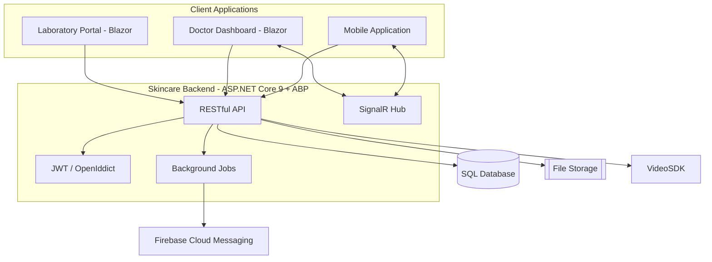

# 🌿 Skincare – Healthcare Platform

**A comprehensive tele-dermatology and skincare platform connecting clients, dermatologists, medical laboratories, and healthcare providers through an integrated digital healthcare ecosystem.**

Skincare enables clients to consult dermatologists remotely, communicate through real-time messaging and video consultations, book medical tests, receive diagnostic results, and follow personalized treatment plans — all through one unified platform.


---

## 📌 Project Overview

Skincare is an integrated healthcare solution designed to simplify dermatological consultations and medical service management.

The platform provides a complete workflow connecting clients with doctors and laboratories, from the initial consultation to diagnosis, medical testing, and treatment delivery.

### Key Highlights

| Component | Description |
|---|---|
| Platform Type | Enterprise Healthcare & Tele-Dermatology System |
| Backend | ASP.NET Core 9 Web API |
| Framework | ABP Framework 9 |
| Architecture | Layered Architecture / Domain-Driven Design |
| Frontend | Blazor Web Dashboards |
| Database | Entity Framework Core |
| Real-Time Communication | SignalR |
| Authentication | JWT / OpenIddict |
| Notifications | Firebase Cloud Messaging |
| Video Consultations | VideoSDK |
| Deployment | Docker & Docker Compose |

### User Roles

- 👤 Clients
- 🩺 Dermatologists
- 🧪 Medical Laboratories
- 🛠 System Administrators

---

## 🏗 System Architecture

The platform follows a modular, layered architecture based on ABP Framework principles and Domain-Driven Design (DDD).

The backend is responsible for business logic, authentication, data persistence, real-time communication, notifications, and integrations with external services.

### High-Level Architecture



### Backend Responsibilities

- Exposing RESTful APIs for different application roles.
- Managing authentication and authorization.
- Handling complex healthcare business workflows.
- Managing real-time communication using SignalR.
- Processing notifications and background operations.
- Integrating external video consultation services.
- Managing database operations through Entity Framework Core.

---

## 🧩 Solution Structure

The project is organized into separate layers to maintain separation of concerns, maintainability, and extensibility.

```text
Skincare/
│
├── src/
│   │
│   ├── Skincare.Domain.Shared/
│   │   └── Enums, Constants, Localization
│   │
│   ├── Skincare.Domain/
│   │   └── Entities, Business Rules, Seeders
│   │
│   ├── Skincare.Application.Contracts/
│   │   └── DTOs, Interfaces, Routes, Validators
│   │
│   ├── Skincare.Application/
│   │   └── Application Services, Jobs, Mapping, Storage
│   │
│   ├── Skincare.EntityFrameworkCore/
│   │   └── DbContext, Entity Configurations, Migrations
│   │
│   ├── Skincare.HttpApi/
│   │   └── Controllers, SignalR Hubs, Filters
│   │
│   ├── Skincare.HttpApi.Host/
│   │   └── API Host, Authentication, Swagger
│   │
│   ├── Skincare.HttpApi.Client/
│   │   └── Typed API Client Proxies
│   │
│   ├── Skincare.DbMigr
